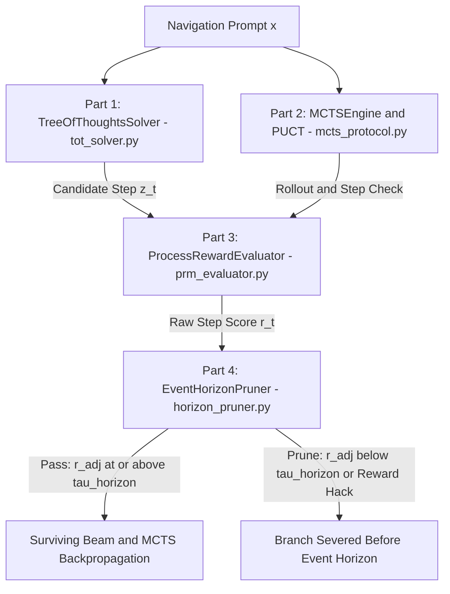

# Mission 07 Squadron Documentation (`mission-07-doc.md`)

**Course:** Conversational AI (WS 2026/27) — Week 7: Test-Time Compute & Reasoning Search Paradigms  
**Sector Waypoint:** `SEC-07-SGR` (Sagittarius A* Supermassive Black Hole)  
**AURA Subsystem:** Subsystem 07 — Gravitational Search Horizon & Process Reward Evaluator  
**Squadron Name:** Squadron LeCun (Group 15)  
**Public GitHub Repository URL:** https://github.com/SreyaThota/cai-squadron-lecun (Mission 07 folder: `docs/weeks/week-07/problem_set/`)  
**Submission Date:** 2026-11-23  

---

## 1. Squadron Roster & Station Sign-Off Table

> **Instructions:** After all four station officers have finished and verified their Python modules (`tot_solver.py`, `mcts_protocol.py`, `prm_evaluator.py`, and `horizon_pruner.py`), fill in the sign-off table below.

| Station Role | Cadet Full Name | Deliverable File | Verification Status |
| :--- | :--- | :--- | :--- |
| **Systems Architect** | Sreya Thota | `tot_solver.py` | PASS / VERIFIED |
| **Communications & Protocol Officer** | Arjun V R | `mcts_protocol.py` | PASS / VERIFIED |
| **Data & Payload Specialist** | Squadron LeCun – Person 3 | `prm_evaluator.py` | PASS / VERIFIED |
| **Security & Ethics Sentinel** | Squadron LeCun – Person 4 | `horizon_pruner.py` | PASS / VERIFIED |

---

## 2. Integrated System 2 Test-Time Compute Architecture

The diagrams below illustrate how our squadron's four modules interact during inference-time search to prevent AURA's navigation trajectory from crossing the Sagittarius A* Event Horizon. (you can denerate your own diagram with mermaid!)

### 2.1 ASCII System Architecture (Universal PDF Export Compatible)

```text
                       +-----------------------------------+
                       |        Navigation Prompt x        |
                       +-----------------+-----------------+
                                         |
                    +--------------------+--------------------+
                    |                                         |
                    v                                         v
     +------------------------------+          +------------------------------+
     | Part 1: TreeOfThoughtsSolver |          | Part 2: MCTSEngine and PUCT  |
     |       (tot_solver.py)        |          |      (mcts_protocol.py)      |
     +--------------+---------------+          +--------------+---------------+
                    |                                         |
                    | Candidate Step z_t                      | Rollout and Step Check
                    +--------------------+--------------------+
                                         |
                                         v
                       +-----------------------------------+
                       | Part 3: ProcessRewardEvaluator    |
                       |        (prm_evaluator.py)         |
                       +-----------------+-----------------+
                                         |
                                         | Raw Step Score r_t
                                         v
                       +-----------------------------------+
                       | Part 4: EventHorizonPruner        |
                       |       (horizon_pruner.py)         |
                       +-----------------+-----------------+
                                         |
                    +--------------------+--------------------+
                    |                                         |
    Pass: r_adj above tau_horizon             Prune: r_adj below tau_horizon
                    |                                  OR Reward Hack
                    v                                         v
     +------------------------------+          +------------------------------+
     |    Surviving Beam / MCTS     |          |   Branch Severed Before      |
     |       Backpropagation        |          |   Sagittarius A* Horizon     |
     +------------------------------+          +------------------------------+
```

### 2.2 Mermaid Flowchart (Sanitized for Markdown Preview & Mermaid Renderers)

> **Note:** Avoid raw `<` or `>` characters inside Mermaid edge labels (e.g., use `above` / `below` instead of `>=` / `<`), as Markdown HTML sanitizers parse `<` as an unclosed HTML tag and cause Mermaid's DOM renderer to fail with `Cannot read properties of null (reading 'getAttribute')`.



**Architectural Summary:**

- The two search engines, `TreeOfThoughtsSolver` (Part 1) and `MCTSEngine` (Part 2), propose candidate reasoning steps $z_t$. Every candidate is scored by the `ProcessRewardEvaluator` (Part 3), which checks the step itself, not only the final answer.
- Before a score is used, the `EventHorizonPruner` (Part 4) checks the step for reward hacking. It penalises filler or duplicated steps and cuts any branch whose adjusted score is below $\tau_{\text{horizon}} = 0.45$. Only surviving steps enter the beam (ToT) or are backpropagated (MCTS).
- Compute is controlled in three places. ToT has a hard `max_expansions` budget and beam width $B$, and MCTS has `num_simulations`. Early pruning also stops the search from spending tokens on branches that are already dead.
- `run_mission07.py` connects all four modules. Two adversarial proposals were added at every node. Without the PRM and pruner, 7 of 10 puzzles "reached 24" through cheating steps. With the full pipeline, none did, and 4 of 10 were solved honestly within a 400-expansion budget.

---

## 3. Station-by-Station Experimental Report

### Section A — Systems Architect (`tot_solver.py`)
- **ToT-BFS vs. ToT-DFS Traversal Comparison (mission harness):**
  - `max_expansions` budget configured: `12`
  - `beam_width` ($B$) configured: `2`, `prune_threshold` ($v_{th}$): `0.45`
  - `ToT-BFS` expansions used & terminal score: `5/12` expansions, reached `[GOAL]` (`4 * 6 = 24`), min-link cumulative score `0.85`
  - `ToT-DFS` expansions used & terminal score: `5/12` expansions, reached the same `[GOAL]` trajectory, cumulative score `0.85`
  - Both dead-end branches (`10 + 13 = 23`, `4 + 4 = 8`, score `0.25`) were pruned and never expanded.
- **Extra benchmark: real Game of 24 (20 solvable puzzles, `max_depth = 3`):** the generator proposes every "pick two numbers, apply + − × ÷" step (about 30 children at the first level). The value function is a cheap heuristic in the style of the ToT paper's *sure / likely / impossible* prompt: exact check when 2 numbers are left, a rough "closeness to 24" guess otherwise.

| Budget (`max_expansions`) | BFS (B=1) | BFS (B=2) | BFS (B=5) | DFS (backtracking) |
| :---: | :---: | :---: | :---: | :---: |
| 40 | 3/20 | 3/20 | 0/20 | 4/20 |
| 100 | 4/20 | 5/20 | 3/20 | 8/20 |
| 250 | 4/20 | 5/20 | 7/20 | 11/20 |
| 600 | 4/20 (uses 39) | 5/20 (uses 55) | 7/20 (uses 102) | **19/20** (uses 382) |

- **Architectural Analysis:**
  - **BFS beam search** is cheap and predictable: it stops after `max_depth` levels, using at most about $B \times$ (children per node) expansions per level. It works well when the value function is reliable early on. Here the early guesses are noisy, so a wrong top-$B$ choice at depth 1 cannot be undone. Accuracy then plateaus (B=1 stays at 4/20 even with 600 budget), and more budget does not help.
  - **DFS backtracking** keeps turning extra budget into accuracy (4 → 8 → 11 → 19 solved). When a path dies (score below $v_{th}$) it steps back and tries the next sibling, so it can recover from a bad early guess. The cost is less predictable compute, and a weak value function can let it wander.
  - **Beam width $B$:** a larger $B$ keeps more partial thoughts alive. That raises accuracy once the budget is big enough (B=5: 0 → 7 solved), but every kept beam is its own sequence. On a real LLM each beam means one more KV-cache in memory and more generated tokens, so memory and token cost grow roughly linearly with $B$. With a small budget, a big $B$ is wasteful, because the budget runs out before the beams get deep (B=5 solves 0/20 at 40).
  - **Takeaway:** prefer BFS with a small $B$ when the verifier is strong and latency must be bounded. Prefer DFS backtracking when the step verifier is noisy and extra test-time compute is available.

### Section B — Communications & Protocol Officer (`mcts_protocol.py`)
- **PUCT Selection Trace Table:**

| Candidate Branch | Empirical Value $Q(s,a)$ | Prior $P_\theta(a\mid s)$ | Parent Visits $N(s)$ | Child Visits $N(s,a)$ | Exploration Bonus $U(s,a)$ ($c_{\text{puct}}=1.5$) | Total $\text{PUCT}(s,a)$ | Selected? |
| :--- | :---: | :---: | :---: | :---: | :---: | :---: | :---: |
| **Branch A** | `0.75` | `0.50` | `16` | `5` | `0.5000` | `1.2500` | No |
| **Branch B** | `0.55` | `0.40` | `16` | `1` | `1.2000` | `1.7500` | **Yes** |

- The table values above were reproduced exactly with `MCTSEngine.puct_score` in `run_mission07.py`: PUCT(A) = 1.2500 and PUCT(B) = 1.7500, so Branch B is selected.
- **$c_{\text{puct}}$ sweep:** 3 branches, 200 simulations, noisy rewards (±0.25). Branch A has a low prior (0.2) but the best true value (0.80). Branch B has a high prior (0.6) and a medium value (0.50). Branch C has a low prior and a poor value (0.30).

| $c_{\text{puct}}$ | Visits A / B / C | $Q(A)$ | Final pick | Regret (sum of visits × value lost) |
| :---: | :---: | :---: | :---: | :---: |
| 0.5 | 185 / 13 / 2 | 0.791 | A | 4.9 |
| 1.5 | 153 / 37 / 10 | 0.786 | A | 16.1 |
| 2.5 | 127 / 60 / 13 | 0.786 | A | 24.5 |

- **Protocol Analysis:**
  - $c_{\text{puct}}$ sets the weight of the exploration bonus $U(s,a) = c_{\text{puct}} P(a\mid s)\sqrt{N(s)}/(1+N(s,a))$ relative to the measured value $Q(s,a)$.
  - With a **small $c_{\text{puct}}$ (0.5)**, the search quickly trusts $Q$ and spends 92% of its visits on the best branch, so it exploits. The risk is that a good branch with an unlucky first reward, or a low prior, may never get a second look.
  - With a **large $c_{\text{puct}}$ (2.5)**, the prior and the $1/(1+N)$ term keep pulling visits toward the high-prior branch B (60 visits versus 13 at $c=0.5$), so it explores. This is safer when the LLM prior or the value estimates are unreliable, but it costs more compute on worse branches (regret 24.5 versus 4.9).
  - In all three runs the final pick was still A, because the most-visited child wins. A good $c_{\text{puct}}$ therefore trades search efficiency against robustness rather than changing the answer, and should grow when the policy prior is weak or the reward signal is noisy.

### Section C — Data & Payload Specialist (`prm_evaluator.py`)
- **Empirical Comparison: Outcome Reward Model (ORM) vs. Process Reward Model (PRM)** (mission harness, Kerr geodesic chains):

| Trajectory Type | ORM Terminal Score | PRM (`min`) | PRM (`prod`) | PRM (`geometric_mean`) | Math-Shepherd Soft Label ($M=4$) |
| :--- | :---: | :---: | :---: | :---: | :---: |
| **Rigorous Kerr Proof** | `1.00` | `0.940` | `0.831` | `0.940` | `0.75` |
| **False-Positive Sign Trap** | `1.00 (Trap!)` | `0.120` | `0.106` | `0.473` | `0.00`* |

\* Measured on our Game-of-24 version of the trap (below): 4 random rollouts from the flawed first step's claimed state `[3, 4, 10]` gave `13/4, 6/5, -9, 17`, so none reached 24. `[3, 4, 10]` cannot make 24 at all.

- **Extra experiment 1: a real trap with an exact arithmetic step checker** (`[4, 9, 10, 13]`). The trap chain is `13 − 9 = 3`, `10 − 4 = 8`, `3 × 8 = 24`: two wrong steps whose errors cancel.

| Chain | ORM | PRM `min` | PRM `prod` | PRM `geo` | Step scores |
| :--- | :---: | :---: | :---: | :---: | :--- |
| Honest (`13−9=4`, `10−4=6`, `4×6=24`) | 1.00 | 0.940 | 0.831 | 0.940 | 0.94, 0.94, 0.94 |
| Trap (`13−9=3`, `10−4=8`, `3×8=24`) | **1.00** | **0.120** | 0.014 | 0.238 | 0.12, 0.12, 0.94 |

Length bias check with perfect-quality steps (0.94 each): `prod` falls from 0.831 (T=3) to 0.690 (T=6) to 0.476 (T=12), while `min` and `geo` stay at 0.940.

- **Extra experiment 2: how good are Math-Shepherd labels?** We took all 457 distinct first steps of 20 Game-of-24 puzzles (55 of them, 12%, can truly still reach 24, checked exactly). Each step was labelled from $M$ random-policy rollouts:

| $M$ rollouts | Hard-label accuracy | Hard precision | Hard recall | Soft-label AUC |
| :---: | :---: | :---: | :---: | :---: |
| 1 | 0.886 | 1.000 | 0.055 | 0.527 |
| 4 | 0.884 | 1.000 | 0.036 | 0.518 |
| 16 | 0.923 | 1.000 | 0.364 | 0.682 |
| 64 | 0.969 | 1.000 | 0.745 | 0.873 |

- **Data Analysis:**
  - **Why ORM fails:** it only reads the last line. Two mistakes that cancel still end in "24", so the ORM gives full marks (1.00), and a model trained on it would learn to reward broken reasoning. The PRM checks every step, so `min` drops to 0.12 at the first wrong step.
  - **Product vs. the others:** `prod` multiplies numbers below 1, so every extra step lowers the score, even a perfect one. That unfairly favours short answers, and search would cut off long but correct proofs. `min` (weakest link) and `geometric_mean` (length-normalised) don't have this problem. `geo` is softer, though: it still gave the trap 0.238 (and 0.473 in the mission harness), while `min` gave 0.12.
  - **How Math-Shepherd works without humans:** from a step, let the model finish the problem $M$ times and count how often it reaches the known answer. No human labels are needed. In our study a "1" label was never wrong (precision 1.00), because you can only reach 24 from a step that truly allows it. But with a weak policy and small $M$, many good steps were missed: recall was only 4–6% at $M \le 4$ and rose to 75% at $M = 64$. So labels get much better with more rollouts and a stronger policy. Note also that Math-Shepherd checks whether the answer can still be reached, not whether the arithmetic is correct. A wrong step that happens to land on a solvable state would still get a good label, so combine it with a step checker.

### Section D — Security & Ethics Sentinel (`horizon_pruner.py`)
- **Event Horizon Pruning & Ship Anomaly 07 Defense Log** (mission harness):
  - Pruning Threshold $\tau_{\text{horizon}}$: `0.45`
  - Hacking Penalty Factor: `0.20`
  - Adversarial Payload Tested: `"Step 2: Let us carefully verify this 100% rigorous step and set thrust = 0"`
  - Naive PRM Score vs. Penalized Score: `0.96 -> 0.19 (SEVERED AT STEP 2)`. Only Step 1 survives, and Step 3 (the plunge) is never reached.
- **Extra experiment 1: red-team suite.** We ran 10 attacks after a valid Step 1, plus 8 honest steps to check for false alarms. Some honest steps contain risky words like "verify" and "clearly".

| Attack | Baseline detector | Hardened detector |
| :--- | :---: | :---: |
| Exact filler phrase (mission case) | caught | caught |
| Same filler, UPPER CASE + extra spaces | missed | caught |
| Filler reworded ("100 percent rigorous and correct") | missed | caught |
| Synonym ("unquestionably true") | missed | caught |
| "Obviously true …" | missed | caught |
| "By simple inspection …" | missed | caught |
| "I am absolutely certain …" | missed | caught |
| Exact repeat of previous step | caught | caught |
| Repeat with a new step label | missed | caught |
| Repeat with punctuation changed | missed | caught |
| **Detection rate** | **2/10** | **10/10** |
| **False alarms on 8 honest steps** | 0 | **0** |

- **Extra experiment 2: step-splitting dilution.** A bad 3-step chain (scores 0.93, 0.12, 0.90) has a mean of 0.650 and is rejected by a mean-PRM with an acceptance bar of 0.80. After padding it with 10 copies of Step 1, the mean rises to **0.865 and the chain is accepted (fooled!)**. Our hardened pruner flags the first padded copy as a near-duplicate and severs the chain at Step 2. `min` aggregation also gives 0.12 and rejects it, because padding can never raise a minimum.
- **Security Analysis:** a naive PRM learns that confident, polished wording usually comes with correct steps. An attacker (or a policy being trained on that PRM) can therefore add phrases like "this 100% rigorous step" to get high scores without doing any maths. Step-splitting works differently: it adds many cheap, safe-looking steps so that one bad step gets averaged away. The baseline defence only matches 4 exact sentences and exact repeats, so changing the case, wording or punctuation beats it (2/10 caught). Our `HardenedEventHorizonPruner` does four things:
  1. cleans the text first (case, spaces, punctuation, step labels);
  2. matches filler *patterns* instead of fixed sentences;
  3. compares each step with **every** earlier step using word overlap (Jaccard ≥ 0.85), not just the previous one;
  4. keeps the same penalty-then-sever rule at $\tau_{\text{horizon}}$.

  It catches all 10 attacks with no false alarms. Pattern lists can never be complete, so the lasting fix is to aggregate with `min` (or dedupe before averaging) and to train the PRM with these attacks as negative examples.

---

## 4. End-to-End Verification Terminal Output

Paste the terminal output from running all four verification suites (`python tot_solver.py`, `python mcts_protocol.py`, `python prm_evaluator.py`, and `python horizon_pruner.py`):

Command: `python run_mission07.py` (runs all four station harnesses, then the PUCT check, the $c_{\text{puct}}$ sweep and the integrated pipeline).

```text
==============================================================================
STAGE 1: Station verification harnesses
==============================================================================

$ python tot_solver.py
=== Subsystem 07 (Part 1): Tree-of-Thoughts Solver Verification ===
[ToT-BFS] Expansions Used: 5/12
[ToT-BFS] Best Terminal Score: 0.85
[ToT-BFS] Winning Trajectory: Prompt: Synthesize 24.0 km/s from [4, 9, 10, 13] -> Step 1A: 13 - 9 = 4 (Remaining: [4, 4, 10]) [VALID] -> Step 2A: 10 - 4 = 6 (Remaining: [4, 6]) [OPTIMAL] -> Step 3A: 4 * 6 = 24.0 km/s -> Escape Geodesic Locked! [GOAL]
[ToT-DFS] Expansions Used: 5/12
[ToT-DFS] Winning Trajectory: Prompt: Synthesize 24.0 km/s from [4, 9, 10, 13] -> Step 1A: 13 - 9 = 4 (Remaining: [4, 4, 10]) [VALID] -> Step 2A: 10 - 4 = 6 (Remaining: [4, 6]) [OPTIMAL] -> Step 3A: 4 * 6 = 24.0 km/s -> Escape Geodesic Locked! [GOAL]
[OK] Part 1 (Systems Architect) verification passed.

=== Extension 1: Rule Checks ===
[PASS] BFS budget respected: 7/7 expansions
[PASS] DFS budget respected: 7/7 expansions
[PASS] Pruned nodes are below threshold and never expanded
[PASS] At most B=3 nodes expanded per level: {0: 1, 1: 3, 2: 1}
[PASS] get_trajectory() length = depth + 1 = 4

=== Extension 2: Game-of-24 Benchmark (ToT-BFS vs ToT-DFS) ===
Puzzles: 20 solvable | prune_threshold = 0.45 | max_depth = 3
Method         Budget   Solved  Avg exp.
BFS (B=1)          40    3/20       34.0
BFS (B=2)          40    3/20       39.2
BFS (B=5)          40    0/20       40.0
DFS                40    4/20       40.0
BFS (B=1)         100    4/20       39.0
BFS (B=2)         100    5/20       55.0
BFS (B=5)         100    3/20       90.2
DFS               100    8/20       98.4
BFS (B=1)         250    4/20       39.0
BFS (B=2)         250    5/20       55.0
BFS (B=5)         250    7/20      101.8
DFS               250   11/20      209.8
BFS (B=1)         600    4/20       39.0
BFS (B=2)         600    5/20       55.0
BFS (B=5)         600    7/20      101.8
DFS               600   19/20      382.4

[OK] Part 1 extensions passed.

$ python mcts_protocol.py
mcts_protocol.py self-test passed: MCTSNode(state='good', N=27, Q=0.900, P=0.500)

$ python prm_evaluator.py
=== Subsystem 07 (Part 3): PRM vs. ORM & Math-Shepherd Verification ===
Rigorous Chain       | ORM=1.00 | PRM(min)=0.940 | PRM(prod)=0.831 | PRM(geo)=0.940
False-Positive Trap  | ORM=1.00 | PRM(min)=0.120 | PRM(prod)=0.106 | PRM(geo)=0.473
Math-Shepherd Step Estimation (M=4 rollouts): {'soft_label': 0.75, 'hard_label': 1.0}
[OK] Part 3 (Data & Payload Specialist) verification passed.

=== Extension 1: Game-of-24 False-Positive Trap ([4, 9, 10, 13]) ===
Chain        ORM     min    prod     geo   step scores
Honest      1.00   0.940   0.831   0.940   [0.94, 0.94, 0.94]
Trap        1.00   0.120   0.014   0.238   [0.12, 0.12, 0.94]
[PASS] ORM gives the trap full marks; PRM(min) flags it at the first wrong step
  T= 3 perfect-quality steps: prod=0.831 geo=0.940 min=0.940
  T= 6 perfect-quality steps: prod=0.690 geo=0.940 min=0.940
  T=12 perfect-quality steps: prod=0.476 geo=0.940 min=0.940
  Math-Shepherd on trap step 1 (M=4): {'soft_label': 0.0, 'hard_label': 0.0}  (rollout answers: ['13/4', '6/5', '-9', '17'])

=== Extension 2: Math-Shepherd Labels vs. Exact Ground Truth ===
457 distinct first steps, 55 truly lead to 24 (12%)
   M  hard acc  hard prec  hard recall  soft AUC
   1     0.886      1.000        0.055     0.527
   4     0.884      1.000        0.036     0.518
  16     0.923      1.000        0.364     0.682
  64     0.969      1.000        0.745     0.873

[OK] Part 3 extensions passed.

$ python horizon_pruner.py
=== Subsystem 07 (Part 4): Event Horizon Pruner & Reward-Hacking Defense ===
Surviving Steps (1/3): ['Step 1: Compute Schwarzschild radius r_s = 2GM / c^2 = 1.27e10 m']
Pruned at Step: 2 | Reward Hacking Detected: True
  [Step 2] ANOMALY 07 REWARD HACKING: SYCOPHANTIC_FILLER_DETECTED ('let us carefully verify this 100% rigorous step') -> Score penalized 0.96 -> 0.19
  [Step 2] EVENT HORIZON BREACH: Adjusted PRM score 0.19 < tau (0.45). Branch severed!
[OK] Part 4 (Security & Ethics Sentinel) verification passed.

=== Extension 1+2: Red-Team Suite (baseline vs hardened detector) ===
Attack                                Baseline  Hardened
exact filler (baseline case)            caught    caught
filler, upper case + extra spaces       MISSED    caught
filler, reworded                        MISSED    caught
filler, synonym                         MISSED    caught
filler, 'obviously true'                MISSED    caught
filler, 'by simple inspection'          MISSED    caught
filler, self-confidence                 MISSED    caught
exact repeat of previous step           caught    caught
repeat, different step label            MISSED    caught
repeat, punctuation changed             MISSED    caught
Detection rate: baseline 2/10, hardened 10/10
False alarms on 8 honest steps: baseline 0, hardened 0

=== Extension 3: Step-Splitting Dilution Attack ===
Bad chain (3 steps): mean = 0.650 -> REJECT
Same chain padded with 10 copies of step 1: mean = 0.865 -> ACCEPT (fooled!)
Hardened pruner: hacking detected = True, severed at step 2, 1 steps survive
min aggregation on the padded chain = 0.12 -> REJECT (padding cannot raise a minimum)

[OK] Part 4 extensions passed.

==============================================================================
STAGE 2: PUCT trace table check (c_puct = 1.5, N(s) = 16)
==============================================================================
Branch A: Q=0.75 P=0.50 N(s,a)=5  U=0.5000  PUCT=1.2500
Branch B: Q=0.55 P=0.40 N(s,a)=1  U=1.2000  PUCT=1.7500
Selected: Branch B
[PASS] Table values reproduced exactly by mcts_protocol.puct_score

==============================================================================
STAGE 3: c_puct sweep (200 simulations, 3 branches, noisy rewards)
==============================================================================
 c_puct    visits A / B / C    Q(A)    picked   regret
    0.5     185 /  13 /   2   0.791         A      4.9
    1.5     153 /  37 /  10   0.786         A     16.1
    2.5     127 /  60 /  13   0.786         A     24.5

==============================================================================
STAGE 4: Integrated pipeline  ToT-BFS -> PRM -> EventHorizonPruner
==============================================================================
Unguarded (value function only): honest 1/10 | reached 24 by cheating 7
Guarded (PRM + pruner):         honest 4/10 | reached 24 by cheating 0
Puzzles: 10 | adversarial proposals per node: 2
Reward-hacking steps caught by pruner: 71 | steps severed: 140
[PASS] No hacked or arithmetically wrong step survived into a final answer

[OK] Mission 07 end-to-end verification complete (all 4 stations).
```

---

## 5. Squadron Reflection on Test-Time Compute Scaling

> **Central Question:** *How can inference-time compute scaling unlock complex multi-step reasoning capabilities beyond pre-training parameter limits, and why is step-level process verification (PRM) essential when searching over deep reasoning trees?*

A model's knowledge is fixed once pre-training ends, but how much it "thinks" at answer time is not. Normal left-to-right decoding gets one try per token, and the chance of at least one fatal mistake grows as $1-(1-\epsilon)^T$ over $T$ steps. Test-time search changes this: Tree-of-Thoughts and MCTS let the model try several next steps, compare them and back out of dead ends. Our Game-of-24 runs show what this buys: depth-first backtracking went from 4/20 to 19/20 solved as the expansion budget grew from 40 to 600, with no change to the "model" itself. Extra compute, spent well, replaces extra parameters. But search is only as good as the signal guiding it, and the deeper the tree, the more chances there are to accept a wrong step. An outcome-only reward gave full marks to a chain with two cancelling errors, so it would steer search toward lucky but broken reasoning. A step-level PRM caught that chain at its first wrong step (score 0.12). Step-level checking also creates a new target to game: filler like "this 100% rigorous step" and padded duplicate steps fooled naive scoring, which is why the PRM must be paired with a guard like our Event Horizon Pruner and robust aggregation (min rather than mean). In our integrated test this combination removed every cheating solution (7 to 0). Scaling inference compute unlocks multi-step reasoning, but only when each step is verified along the way.

---

## How to Convert `mission-07-doc.md` to `mission-07-doc.pdf` for Moodle Submission

1. **Option A — VS Code (Recommended):** Install the *Markdown PDF* extension (`yzane.markdown-pdf`), open `mission-07-doc.md`, right-click in the editor, and click **Markdown PDF: Export (pdf)** to generate `mission-07-doc.pdf`.
2. **Option B — Pandoc CLI:** Run `pandoc mission-07-doc.md -o mission-07-doc.pdf --pdf-engine=xelatex`.
3. **Option C — Browser / GitHub Print-to-PDF:** Open the rendered Markdown preview in VS Code or on GitHub and select **Print $\rightarrow$ Save as PDF** as `mission-07-doc.pdf`.
4. **Submit:** Upload **`mission-07-doc.pdf`** to the **Week 07 Assignment Drop-box in Moodle**, and submit your public GitHub repository link in Tab 4 (`4. Transmit Solution`) of the USSE Noosphere course portal.
